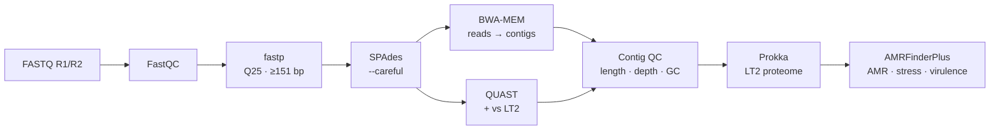
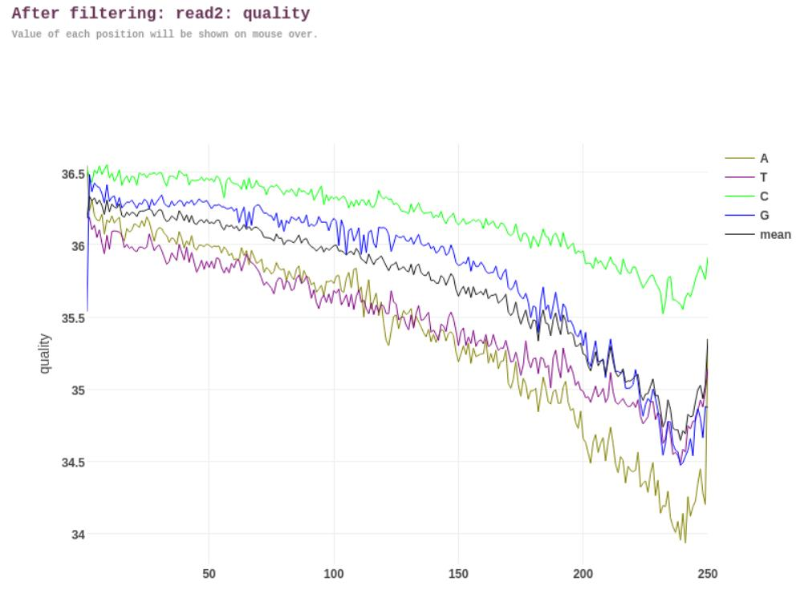
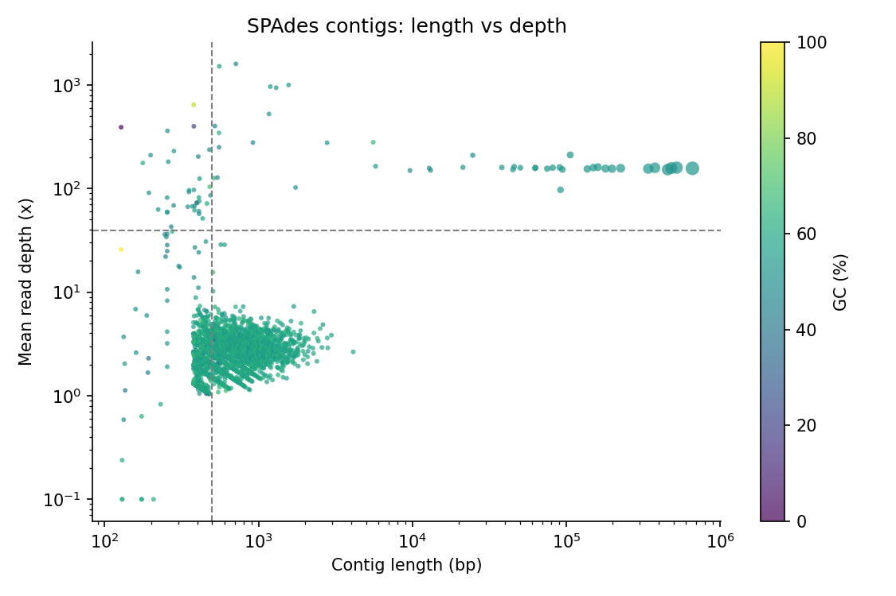
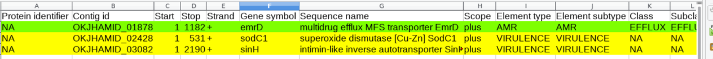

# Bacterial WGS: *Salmonella enterica* assembly, QC and AMR profiling

De novo assembly, quality control, annotation and resistance/virulence profiling of a clinical *Salmonella enterica* isolate (Illumina 2 × 251 bp, SRA [`SRR18072959`](https://www.ebi.ac.uk/ena/browser/view/SRR18072959)).

**Key result:** the raw SPAdes assembly is 7.4 Mb in 4,044 contigs, about 50% larger than a *Salmonella* genome. Read mapping and per-contig depth show that the excess is **2.6 Mb of short, low-depth (~2–6×), high-GC (59%) contigs**, which carry only about 1% of the reads. BLAST identifies most of them as ***Phyllobacterium*** and related Rhizobiales, a low-level contaminant. Removing them leaves **45 contigs, 4.84 Mb, GC 52.2%**, which covers 96% of the *S.* Typhimurium LT2 reference. The annotation goes from 7,225 to **4,555 CDS**, matching the expected gene content. AMRFinderPlus finds no acquired resistance genes or resistance mutations. It detects only the intrinsic efflux pump *emrD*, the virulence genes *sodC1* and *sinH*, and the acid-stress gene *asr*.

## Workflow



| Step | Script | Tools |
|---|---|---|
| Download | `00_download_data.sh` | ENA portal API (reads), NCBI (LT2 genome + GenBank) |
| Raw-read QC | `01_qc_raw.sh` | FastQC |
| Trimming and filtering | `02_trim.sh` | fastp (min. length 151 bp, mean/leading/trailing quality Q25) |
| De novo assembly | `03_assemble.sh` | SPAdes 4.0 `--careful` (k = 21–127) |
| Assembly QC | `04_assembly_qc.sh` | QUAST 5.2 (alone and against LT2), BWA-MEM + samtools coverage |
| Contig QC and filtering | `05_contig_qc.py` | length ≥ 500 bp and depth ≥ 25% of the main-genome depth |
| Annotation | `06_annotate.sh` | Prokka 1.14.6 with the *S.* Typhimurium LT2 RefSeq proteome (4,527 proteins) |
| AMR, stress and virulence | `07_amr_virulence.sh` | AMRFinderPlus 3.11.26, database 2023-11-15.1, `--plus`, ≥ 90% identity and coverage |

## How to run

```bash
git clone https://github.com/Dvid99/salmonella-wgs-amr.git
cd salmonella-wgs-amr
conda env create -f envs/assembly.yml      # FastQC, fastp, SPAdes, QUAST, BWA, samtools
conda env create -f envs/annotation.yml    # Prokka, AMRFinderPlus

conda activate salmonella-assembly
bash scripts/00_download_data.sh
bash scripts/run_all.sh assembly           # steps 1-5

conda activate salmonella-annotation
bash scripts/run_all.sh annotation         # steps 6-7
```

Quick test with 10% of the reads: `CONFIG=config/test.sh bash scripts/00_download_data.sh`, then run the same commands with `CONFIG=config/test.sh`. The full pipeline has been run end to end on Google Colab (2 CPUs, ~3 h, mostly SPAdes) with [`notebooks/run_on_colab.ipynb`](notebooks/run_on_colab.ipynb).

## Results

### Reads

| Metric | Value |
|---|---|
| Raw read pairs | 1,626,620 (2 × 251 bp) |
| Pairs passing fastp | 1,584,755 (82,812 reads too short, 918 with too many N; no adapters detected) |
| Mean length after trimming | 246 bp; duplication 9.0% |
| Expected coverage (Lander–Waterman, 4.95 Mb) | 158× |

<p align="center"></p>

### Assembly and contamination check

| | All contigs | Contigs ≥ 10 kb | **Filtered (kept)** | Removed |
|---|---|---|---|---|
| Contigs | 4,044 | 28 | **45** | 3,999 |
| Total length | 7.42 Mb | 4.81 Mb | **4.84 Mb** | 2.58 Mb |
| GC | 54.7% | 52.2% | **52.2%** | 59.3% |

- **SPAdes** tried k = 21, 33, 55, 77, 99 and 127. The final contigs come from the largest k (127). Largest contig: 660 kb; N50 = 180 kb (contigs ≥ 500 bp).
- **99.7% of the clean reads map back** to the assembly. The kept contigs have a depth of 159× (length-weighted median), matching the expected 158×. The removed contigs have a median depth of 2.3×, so they carry only 1.1% of the sequenced bases.

<p align="center"></p>

The *Salmonella* chromosome appears as a horizontal band at ~160×. The contaminant is a separate cloud of short contigs at 1–7×. The few short, very deep contigs above the band are most likely multi-copy elements of the isolate (for example rRNA operons or insertion sequences), so they are kept.
- **Against *S.* Typhimurium LT2** (QUAST): genome fraction 96.2% and duplication ratio 1.00. 1.92 Mb of the contigs (≥ 500 bp) do not align to LT2. The GC of the whole assembly (54.2%) is above that of the reference (52.2%).
- The 10 misassemblies relative to LT2 most likely reflect real structural differences between this isolate and the Typhimurium reference. They are not necessarily assembly errors.

**What is the contaminant?** A megablast search against NCBI nt of the 20 largest removed contigs (cell 8 of [`notebooks/run_on_colab.ipynb`](notebooks/run_on_colab.ipynb)) gives *Phyllobacterium* sp. as the top hit for 16 of them. Three more hit plasmids of *Mesorhizobium* and *Brucella*, and one hits a phage. All three genera are high-GC Alphaproteobacteria (order Rhizobiales), consistent with the 59% GC of the removed contigs. Low-depth contigs of a different taxon and GC are the typical signature of **low-level contamination** in the library (environmental DNA, or reads carried over from another sample in the same run). They are not part of the isolate's genome, so they were removed before annotation.

### Annotation (Prokka)

| | All contigs (as in the original exercise) | **Filtered contigs** |
|---|---|---|
| Contigs annotated | 4,023 | **45** |
| CDS | 7,225 | **4,555** |
| rRNA / tRNA / tmRNA | 17 / 98 / 2 | **9 / 77 / 1** |

LT2 has about 4,500 protein-coding genes, so the filtered assembly gives the expected gene content. Annotating every contig inflates the CDS count by more than 50%.

### Resistance, stress and virulence (AMRFinderPlus)

| Gene | Type | Description | Method | Identity |
|---|---|---|---|---|
| *emrD* | AMR (efflux) | multidrug efflux MFS transporter EmrD | BLASTP | 92.6% |
| *asr* | Stress (acid) | acid resistance repetitive basic protein | HMM | — |
| *sodC1* | Virulence | Cu-Zn superoxide dismutase SodC1 | EXACTP | 100% |
| *sinH* | Virulence | intimin-like inverse autotransporter SinH | EXACTP | 100% |

<p align="center"></p>

- ***emrD*** is detected by protein similarity (`AMR` subtype, BLASTP), not as a point mutation (`POINT`, POINTX/POINTN). It is a **chromosomal efflux pump intrinsic to Enterobacterales**, not a horizontally acquired resistance gene. On its own it does not predict clinical resistance.
- The run uses AMRFinder's combined mode (proteins + contigs + GFF), which also screens the *Salmonella* point-mutation database (e.g. *gyrA*, *parC*). **No resistance mutations were found.**
- *asr* is reported through its HMM, which is why its identity is not a percentage.
- *sodC1* (protection against oxidative burst in macrophages) and *sinH* (adhesion and invasion) are typical *Salmonella* virulence factors.

## Notes

- SPAdes is run with `--phred-offset 33`: the ENA FASTQs carry binned base qualities, so SPAdes 4.0 cannot detect the encoding by itself.
- The contig filter is deliberately simple (length and relative depth), so it is easy to explain and audit. For routine surveillance, add a taxonomic check of the removed contigs (Kraken2, or BLAST as in the Colab notebook) and a completeness/contamination score (CheckM).
- LT2 (serovar Typhimurium) is used as the annotation and comparison reference, as in the original exercise. The isolate's serovar was not determined; SeqSero2 or SISTR would be the next step.

## References

- Bankevich A *et al.* (2012). SPAdes: a new genome assembly algorithm and its applications to single-cell sequencing. *J Comput Biol* 19:455–477.
- Gurevich A *et al.* (2013). QUAST: quality assessment tool for genome assemblies. *Bioinformatics* 29:1072–1075.
- Seemann T (2014). Prokka: rapid prokaryotic genome annotation. *Bioinformatics* 30:2068–2069.
- Feldgarden M *et al.* (2021). AMRFinderPlus and the Reference Gene Catalog facilitate examination of the genomic links among antimicrobial resistance, stress response, and virulence. *Sci Rep* 11:12728.
- Chen S *et al.* (2018). fastp: an ultra-fast all-in-one FASTQ preprocessor. *Bioinformatics* 34:i884–i890.

## Author

**David Gómez Collado** — MSc Bioinformatics (VIU), BSc Biotechnology (Universidad de Extremadura).
